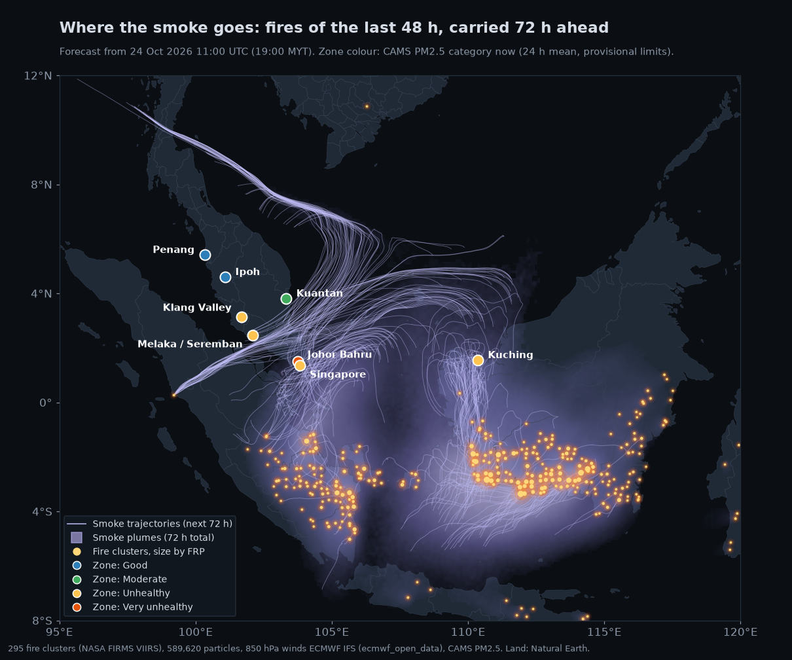
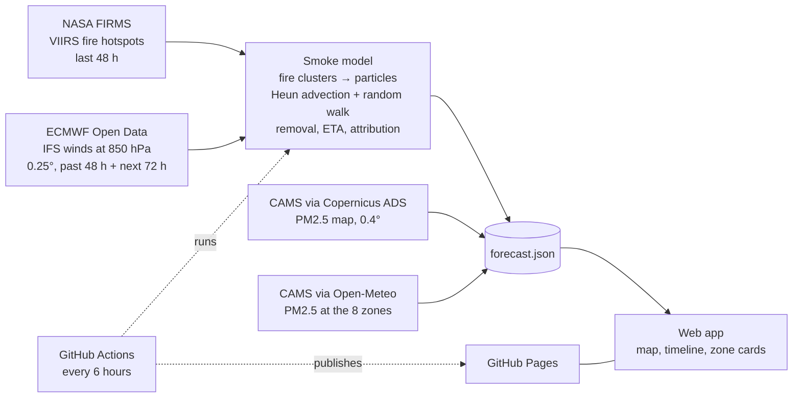
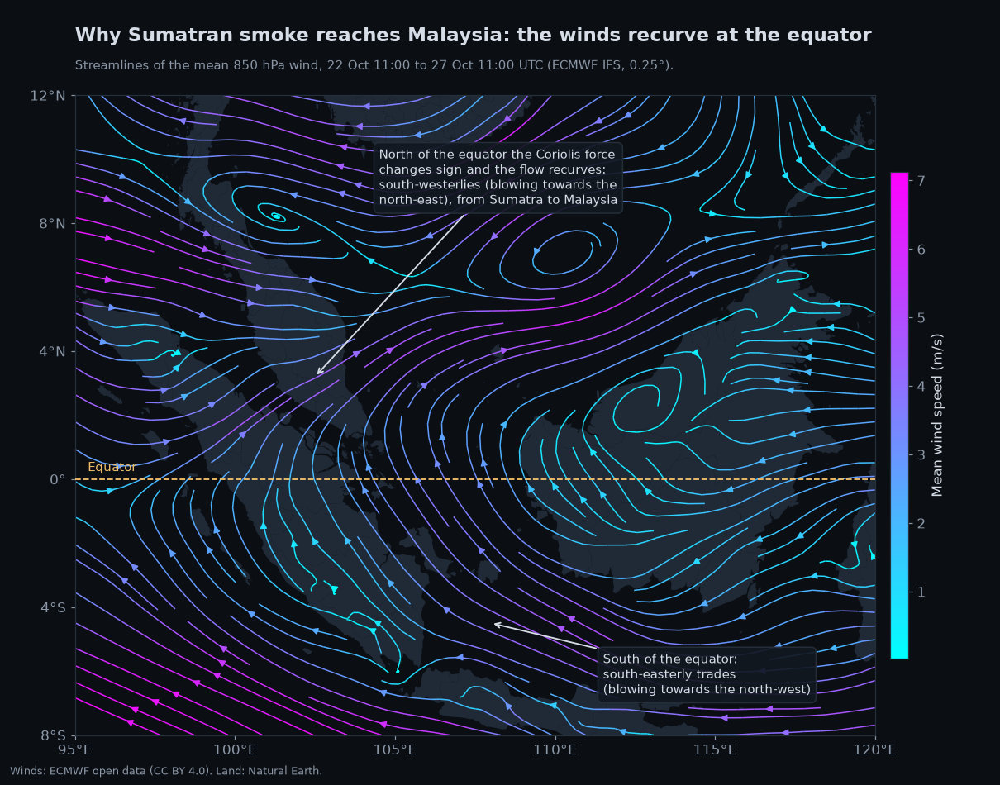
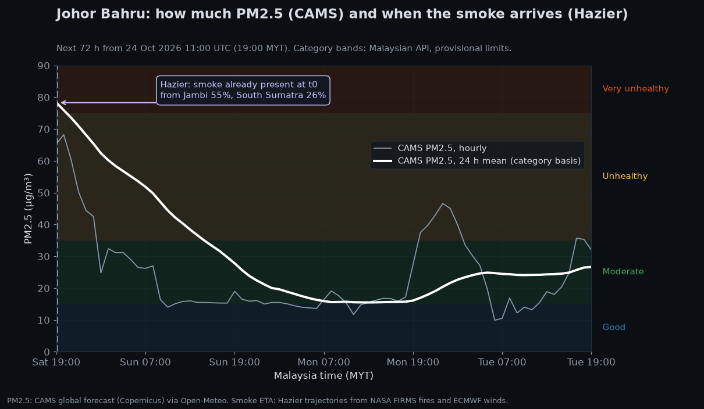

# Hazier

**A haze forecaster for Malaysia and its neighbours: when transboundary smoke from the fires of Sumatra and Borneo will reach each city, and which fires it comes from.**



*Forecast of 24 October 2026, 11:00 UTC. Yellow dots are fire clusters detected by satellite, sized by their radiative power. Lavender lines and shading are the smoke they release, carried by the 850 hPa winds over the next 72 hours. Circles are the forecast zones, coloured by their current air quality category.*

The physics, parameter choices and test results are documented in full in **[docs/methodology.md](docs/methodology.md)**. This page is the overview.

---

## The problem

Every dry season, fires in the peatlands and plantations of Sumatra and Kalimantan (Indonesian Borneo) send smoke across the Strait of Malacca and the South China Sea. This **transboundary haze** can cover Peninsular Malaysia, Singapore and Sarawak for weeks.

The harm comes mostly from **PM2.5**, particles smaller than 2.5 micrometres. They are small enough to reach deep into the lungs and the bloodstream, and they are linked to respiratory and cardiovascular disease. The World Health Organization's guideline for a 24 hour mean is 15 µg/m³; during haze episodes Malaysian cities reach several times that. One study of the 2015 episode estimated about 100,000 excess deaths across Indonesia, Malaysia and Singapore ([Koplitz et al., 2016](https://doi.org/10.1088/1748-9326/11/9/094023)). Schools close, flights are delayed and outdoor work stops.

In Malaysia the public reference is the **Air Pollutant Index (API)** of the Department of Environment, published from its monitoring stations. It is a measurement, and a backward-looking one: its PM2.5 component is a **24 hour moving average**, so it describes the air of the past day. It cannot say whether the smoke is about to arrive, when, or from which fires. By the time the API turns unhealthy, people have already been breathing the smoke for hours.

## What Hazier does

Hazier is built on the best existing sources and adds a layer they do not offer:

| Question | Answered by | Source |
|---|---|---|
| Where are the fires burning? | Satellite fire detections | NASA FIRMS (VIIRS) |
| Where will the wind carry their smoke? | Global weather forecast | ECMWF IFS |
| How much PM2.5 will there be? | Global air quality forecast | CAMS (Copernicus) |
| **When will the smoke reach my city, and from where?** | **Hazier's smoke model** | built on the three above |

**CAMS** (the Copernicus Atmosphere Monitoring Service, run by ECMWF) already forecasts PM2.5 worldwide, including the smoke from these fires, and it is far more accurate on *how much* than anything Hazier could compute. So the air quality level Hazier shows is the CAMS forecast, in the Malaysian API categories. Hazier does not compete with it.

What CAMS does not say is **where the smoke over a city comes from** and **when a plume will arrive**, in words a reader can act on. Hazier answers that with a particle trajectory model: it releases smoke at every fire detected in the last 48 hours, carries it with the forecast winds for 72 hours, and reports, for each zone:

- the **arrival time** of the smoke ("smoke expected in 4 to 6 h", or "already present");
- the **origin** of that smoke by province (for example "Jambi 55%, South Sumatra 26%");
- the **CAMS PM2.5** level now and over the next 72 hours.

The zones are Klang Valley (Kuala Lumpur, Selangor and Putrajaya), Johor Bahru, Melaka and Seremban, Ipoh, Penang, Kuantan, Singapore and Kuching, each a circle of about 50 km radius.

## How it works



Every six hours a GitHub Actions workflow downloads the inputs, runs the model and writes a single file, `forecast.json`. The web app reads only that file, served as a static page: visitors never call an external API. If a source fails, the run either falls back to a secondary source (Open-Meteo for the winds or the map layer) or stops before publishing, so the last valid forecast stays online. Everything runs on free tiers.

## The physics

Each step below is kept deliberately simple and documented, so the forecast can be understood and checked. The methodology has the details and the numbers behind each choice.

### Fire detection and clustering

The **VIIRS** instrument, on three polar-orbiting satellites (Suomi NPP, NOAA-20 and NOAA-21), sees active fires as hot pixels about **375 m** across, each passing over the region roughly twice a day. NASA's FIRMS service delivers these detections within hours. Each comes with its **fire radiative power (FRP)**, in megawatts: the rate at which the fire radiates heat, which grows with the rate at which vegetation burns, and so with the smoke it emits.

In October 2026 the region produced between 9,000 and 16,000 detections in 48 hours. Low-confidence detections are dropped, duplicates seen by two satellites minutes apart are merged, and the rest are grouped into **clusters** on a 0.25 degree grid (about 28 km). Each cluster releases its smoke from the FRP-weighted centre of its hotspots, with a strength equal to its summed FRP. Weak clusters (below 25 MW) and offshore heat sources such as gas flares are left out. [Details](docs/methodology.md#fire-sources)

### Advection at 850 hPa

Smoke is carried by the wind: this transport is called **advection**. Hazier moves all smoke with the wind at a single pressure level, **850 hPa**, about 1.5 km above sea level. Peat and vegetation fire smoke in this region is mostly injected into the **boundary layer**, the lowest 1 to 2 km of the atmosphere that is mixed by turbulence, and it travels long distances near its top. One representative level is the simplest defensible choice.

The winds come straight from the ECMWF model files, on the native 0.25 degree grid. On a sphere of radius $R$, a particle at longitude $\lambda$ and latitude $\varphi$ moves with the eastward and northward wind components $u$ and $v$ as

$$\frac{d\varphi}{dt} = \frac{v}{R}, \qquad \frac{d\lambda}{dt} = \frac{u}{R\cos\varphi}$$



*Why Sumatran smoke reaches Malaysia. South of the equator the trade winds blow from the south-east. As they cross the equator, the **Coriolis force** (the apparent deflection caused by the Earth's rotation, to the left in the southern hemisphere and to the right in the northern) changes sign, and the flow recurves into south-westerlies that carry smoke from Sumatra towards the Malay Peninsula. The pattern is strongest during the south-west monsoon (June to September); this example, from the transition season in late October, shows it in a weaker form.* [Details](docs/methodology.md#wind-field)

### Time integration: the Heun scheme

The equations above are solved step by step with **Heun's method**, a second-order Runge-Kutta scheme, with a time step $\Delta t = 1$ h. Writing the position as $\mathbf{x}$ and the right-hand side as $\mathbf{f}(\mathbf{x}, t)$, each step first predicts where the particle would go with the wind at its start, then corrects with the average of the winds at both ends:

$$\mathbf{x}^{*} = \mathbf{x}_n + \Delta t\,\mathbf{f}(\mathbf{x}_n, t_n)$$

$$\mathbf{x}_{n+1} = \mathbf{x}_n + \frac{\Delta t}{2}\Big[\mathbf{f}(\mathbf{x}_n, t_n) + \mathbf{f}(\mathbf{x}^{*}, t_{n+1})\Big]$$

The error after a fixed time shrinks with the square of the step: halving $\Delta t$ divides it by four. It is the scheme of HYSPLIT, the reference trajectory model of the US National Oceanic and Atmospheric Administration, and with hourly steps it only needs winds at whole hours. Between grid points and between hours the wind is interpolated linearly. [Details](docs/methodology.md#integration)

### Turbulent dispersion: a random walk

A real plume widens as it travels, because eddies smaller than the model grid stir it sideways. This **turbulent dispersion** is represented as diffusion with a constant **eddy diffusivity** $K$, simulated as a random walk: after each step, every particle is displaced by

$$\Delta x = \sqrt{2K\,\Delta t}\;\xi_x, \qquad \Delta y = \sqrt{2K\,\Delta t}\;\xi_y, \qquad \xi \sim \mathcal{N}(0, 1)$$

so a puff spreads with a standard deviation $\sigma(t) = \sqrt{2Kt}$, the solution of the diffusion equation. The value $K = 2 \times 10^{4}$ m²/s comes from **Richardson's law**, the observation that atmospheric diffusivity grows with the size $L$ of the eddies involved:

$$K \approx 0.1\,\varepsilon^{1/3} L^{4/3}$$

where $\varepsilon$ is the rate at which turbulent energy is dissipated. With $\varepsilon \approx 10^{-4}$ m²/s³, typical of the free troposphere, and $L \approx 100$ km, this gives about $2 \times 10^{4}$ m²/s. The length is the scale below which the wind field cannot be trusted to spread the plume: a global model represents features properly only over several grid lengths, about 100 km on its 0.25 degree grid. The result is: a puff about 60 km wide after one day and 100 km after three, comparable to a zone. It is an order-of-magnitude choice, to be tuned against observations. [Details](docs/methodology.md#dispersion)

### Removal: a first-order lifetime

Smoke particles leave the air, mostly washed out by rain (**wet deposition**) and more slowly by settling on surfaces (**dry deposition**). Both are represented together as a first-order loss: the smoke carried by a particle of age $a$ is

$$w(a) = w_0\, e^{-a/\tau}$$

with a lifetime $\tau = 3$ days, the middle of the 2 to 4 days typical of fine smoke aerosol in the humid tropics. After one lifetime, 37% of the smoke is still airborne. [Details](docs/methodology.md#removal)

### Smoke already in the air

When a forecast starts, the smoke of the last two days is already over the region. Hazier includes it: each cluster has been releasing particles every hour since its **first detection** in the last 48 hours, and those particles are carried up to the start of the forecast by the past winds (built from the first hours of the previous ECMWF runs, the closest thing to observed winds the open data offers). They then continue into the forecast with the new ones. Fires are assumed to keep burning at the same strength for the next 72 hours. [Details](docs/methodology.md#particle-release)

### Arrival time and source attribution

For each zone, Hazier sums the smoke of all particles within 50 km of its centre, after removal, into an internal **smoke index**. It is a relative measure of smoke, used only for timing and origin, never shown as air quality. The **ETA** (estimated time of arrival) is the first forecast hour at which the index reaches an arrival threshold. Because dispersion spreads the arrival of a plume over several hours, a range is given too: from the hour the index reaches half the threshold to the hour it reaches twice it.

The **attribution** splits the smoke a zone receives over the 72 hours by the province or state of the fires it came from, using Natural Earth outlines, so the shares always add up to 100%. When the smoke does not reach a zone, no source is shown: trace amounts below the threshold are not presented as a cause. [Details](docs/methodology.md#time-of-arrival-eta)



*One zone, both layers. The white line is the CAMS PM2.5 24 hour mean, the basis of the Malaysian category (coloured bands); the grey line the hourly value. The marker is Hazier's smoke arrival: on this date the smoke from Jambi and South Sumatra was already over Johor Bahru at the start of the forecast, consistent with the very unhealthy level CAMS gives for the first hours.*

## Verification

**Numerical accuracy.** The integrator is tested against known answers. In a uniform wind a particle keeps a constant compass heading, and its exact path (a rhumb line) is known in closed form; on a rotating wind field that strengthens in time, a very fine fourth-order solution serves as reference. In both cases halving the time step divides the error by 4.00, the signature of a second-order method. With the operational 1 h step the error after 72 hours is about 3 km on the rotating field, far below the uncertainty of the winds themselves.


*Position error after 72 hours against the time step, for the two test fields, with a reference line of slope 2. Dispersion is switched off and the test winds are linear in space and time, so the interpolation is exact and only the integrator is measured.*

**Robustness to the removal lifetime.** The removal lifetime $\tau$ is the most uncertain physical parameter. Changing it from 1 to 7 days changes the amount of smoke by a factor of two to three, but hardly what users see: the arrival times stay the same (one zone moves by 1 hour at $\tau = 1$ day), and the share of the main source region moves by about 5 percentage points at most.


*Same fires and winds, five removal lifetimes, for the zones the smoke reached on 24 October 2026.*

**Two independent wind data paths.** The same forecast hour was run with winds decoded from the ECMWF GRIB files (0.25 degrees) and with the same IFS model delivered by Open-Meteo on a 1 degree grid. The zone tables were identical, and the arrival times agreed within 1 hour. Both paths carry the same model, so this checks the ingestion (decoding, units, wind components, time interpolation) rather than the model; the spread between different weather models is discussed under [Limitations](#limitations).

**Comparison with CAMS.** For each zone, Hazier flags whether its smoke arrival and an elevated CAMS level (unhealthy or worse) agree. On 23 October 2026 they agreed on 6 of 8 zones; on 24 October on 5 of 8. The disagreements point to what each one can and cannot see. On 24 October Hazier had the Jambi plume over Kuantan while CAMS kept it moderate: the plume may stay aloft, be diluted below what a 45 km CAMS cell resolves, or be overestimated by Hazier. CAMS had unhealthy air over Klang Valley with no Hazier arrival: CAMS counts all PM2.5, including smoke older than 48 hours and local pollution, which Hazier does not track. Station data will settle these cases. [Details](docs/methodology.md#agreement-between-hazier-and-cams)

**Validation against ground stations: in progress.**

## Limitations

- **One level, no vertical motion.** All smoke moves with the 850 hPa wind. Real smoke spreads over several heights where the wind differs, rises in convection and is trapped near the ground at night.
- **Smoke aloft counts as smoke at ground level.** Hazier says when smoke is over a zone, not whether it mixes down to street level. That is why the air quality shown is CAMS's, not Hazier's.
- **One weather model.** Near the equator the 850 hPa winds are often weak, and global models disagree: on one test morning, wind speeds over central Riau ranged from 2.3 to 6.8 m/s between three models, a factor of three in travel time. Arrival times should be read as indicative.
- **Simple removal and dispersion.** One lifetime and one diffusivity everywhere. Rain bands, which wash smoke out unevenly, are not modelled yet.
- **Persistent fires.** Fires seen in the last 48 hours are assumed to keep burning for 72 hours; new fires are not anticipated, and fires put out by rain keep emitting in the model.
- **FRP is a proxy.** Smouldering peat fires release much smoke for little radiated heat, so their share is probably underestimated. Industrial heat sources on land can be mistaken for fires.
- **No neighbourhood detail.** Zones are about 100 km across and CAMS cells about 45 km. The forecast is regional.
- **Provisional thresholds.** The arrival threshold has not been calibrated against observations, and the Malaysian API category limits for PM2.5 have not yet been checked against the official Department of Environment document; the app labels them as provisional.

## Data sources and credits

| Data | Provider | Used for | Licence |
|---|---|---|---|
| VIIRS active fires (375 m, near real time) | [NASA FIRMS](https://firms.modaps.eosdis.nasa.gov/) | Fire locations and FRP | NASA open data policy, free use with acknowledgement |
| IFS forecasts, 850 hPa winds | [ECMWF Open Data](https://www.ecmwf.int/en/forecasts/datasets/open-data) | Smoke transport | [CC BY 4.0](https://creativecommons.org/licenses/by/4.0/) |
| CAMS global atmospheric composition forecasts | [Copernicus Atmosphere Monitoring Service](https://atmosphere.copernicus.eu/), via the [Atmosphere Data Store](https://ads.atmosphere.copernicus.eu/) and [Open-Meteo](https://open-meteo.com/) | PM2.5 map and zone levels | [CC BY 4.0](https://creativecommons.org/licenses/by/4.0/) (Copernicus licence); contains modified Copernicus Atmosphere Monitoring Service information |
| Weather and air quality API | [Open-Meteo](https://open-meteo.com/) | Zone PM2.5, fallback for winds and map | Data [CC BY 4.0](https://creativecommons.org/licenses/by/4.0/), free API for non-commercial use |
| Admin-1 outlines (provinces, states) | [Natural Earth](https://www.naturalearthdata.com/) | Source regions, coastlines in the figures | Public domain |
| Dark Matter basemap | [CARTO](https://carto.com/attributions) | Web map | Free with attribution, under CARTO's basemap terms |
| Map data | [OpenStreetMap contributors](https://www.openstreetmap.org/copyright) | Web map (through CARTO) | [ODbL](https://opendatacommons.org/licenses/odbl/) |

## Stack and architecture

| Part | Technology | Where |
|---|---|---|
| Pipeline | Python 3.11+, numpy, pandas, eccodes (GRIB decoding), ecmwf-opendata, cdsapi | [`pipeline/`](pipeline/) |
| Web app | Vite, TypeScript, MapLibre GL JS, deck.gl, Tailwind CSS | [`web/`](web/) |
| Automation | GitHub Actions every 6 hours, GitHub Pages | [`.github/workflows/forecast.yml`](.github/workflows/forecast.yml) |

```
pipeline/hazier/
  sources/     firms.py, ecmwf.py, ads.py, cams.py, winds.py (fallback), grib.py
  model/       trajectories.py (clusters, release, Heun advection, dispersion), smoke.py (index, ETA, attribution), regions.py
  schema.py    the forecast.json contract, validated before writing
  export.py    the full run, fallbacks, history
pipeline/scripts/make_figures.py   the figures of this page
web/src/       data/ (loading, validation), map/ (deck.gl layers), ui/ (timeline, zone card, panels)
docs/          methodology.md, figures/
```

The pipeline and the web app share one contract, `forecast.json`, typed on both sides (`pipeline/hazier/schema.py` and `web/src/data/types.ts`) and validated before it is written. The run history (one line per run) is committed by the workflow to a separate `data` branch.

## Run locally

**Pipeline and tests** (Windows commands; on Linux or macOS use `python3 -m venv` and `.venv/bin/`):

```
cd pipeline
py -3.12 -m venv .venv
.venv\Scripts\activate
pip install -e ".[dev]"
pytest
```

**Keys.** A full run needs two free keys, kept in `pipeline/.env` (git-ignored):

- `FIRMS_MAP_KEY`: request one at [firms.modaps.eosdis.nasa.gov/api/map_key](https://firms.modaps.eosdis.nasa.gov/api/map_key/).
- `ADS_API_KEY`: create an account on the [Atmosphere Data Store](https://ads.atmosphere.copernicus.eu/), copy your personal access token, and accept the licence of the dataset "CAMS global atmospheric composition forecasts" once on its download page. Without it the map layer falls back to a coarse Open-Meteo grid.

```
copy .env.example .env        # then fill in FIRMS_MAP_KEY and ADS_API_KEY
.venv\Scripts\python.exe -m hazier
```

A run takes about 3 to 5 minutes. It writes `pipeline/output/site/forecast.json`, appends a line to `pipeline/output/history/runs.csv` (both git-ignored) and prints a summary: the sources and model runs used, missing data, and per zone the CAMS level, smoke ETA and main source. ECMWF fields and the ADS file are cached, so repeated runs are fast. Use `--no-history` for test runs. Exit codes: 0 forecast written, 1 no usable forecast, 2 forecast failed validation (in both failure cases the previous file is kept).

Single steps, for debugging (from `pipeline/`):

```
.venv\Scripts\python.exe -m hazier.sources.firms     # fire hotspots per satellite
.venv\Scripts\python.exe -m hazier.sources.ecmwf     # 850 hPa winds from ECMWF open data
.venv\Scripts\python.exe -m hazier.sources.ads       # CAMS PM2.5 map layer from the ADS
.venv\Scripts\python.exe -m hazier.sources.cams      # CAMS PM2.5 at the zones
.venv\Scripts\python.exe -m hazier.model.smoke       # full model, zone table and removal sensitivity
```

**Figures.** All figures on this page are made from real data by one script, which saves the inputs as a snapshot so the same figures can be drawn again:

```
.venv\Scripts\python.exe scripts\make_figures.py                        # fetch, snapshot, draw into docs/figures/
.venv\Scripts\python.exe scripts\make_figures.py --snapshot .cache\figures\snapshot-YYYYMMDDTHHMM.npz
```

**Web app** (from `web/`):

```
npm install
npm run dev        # http://localhost:5173, shows a sample forecast
npm test
npm run build      # then copy pipeline/output/site/forecast.json into web/dist/ and run: npm run preview
```

## Roadmap

**Phase 1, the first public version.** Fire ingestion, ECMWF winds, the trajectory model, arrival times and attribution, CAMS levels, the web app with its map, timeline and zone cards, and the automation are done, and the full run is validated on GitHub. Next: visual polish, then the public launch, when the six-hourly schedule starts.

**Phase 2, a verified product.**
- Readings from the Malaysian monitoring stations (APIMS), kept as a history, and verification of Hazier and CAMS against them, with the scores shown in the app.
- A backtest on the August to September 2026 haze episode.
- Better physics: several vertical levels, emissions weighted by fire type (using CAMS GFAS fire emissions), washout by forecast rain, and a small ensemble of weather forecasts to show the uncertainty of arrival times.
- A satellite aerosol layer (Himawari or Sentinel-5P).
- Per-zone pages, plain-language explanations and a Malay translation.

**Phase 3, further.** Neighbourhood-scale PM2.5 from station data and machine learning, alerts (Telegram or push notifications), more countries, and a custom domain.
