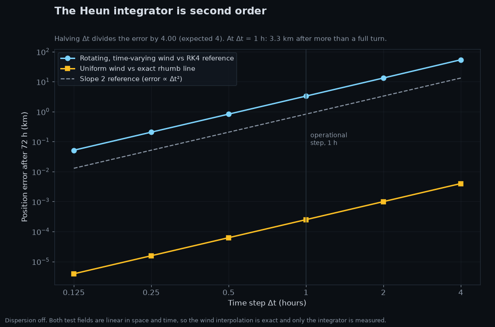
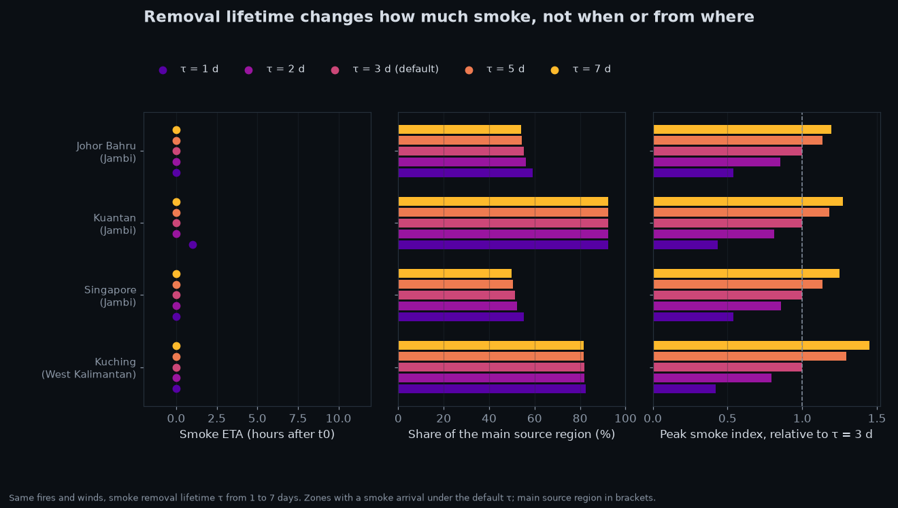

# Methodology

## Overview

Hazier forecasts transboundary smoke for Malaysia and its neighbours. It splits the job with CAMS:

- **Air quality** (how much PM2.5, and its Malaysian API category) comes from the CAMS forecast, per zone and as a map layer.
- **Hazier** adds what CAMS does not say: when the smoke of the fires detected in the last 48 h arrives at each zone, which provinces it comes from, and the paths it takes, from a particle trajectory model driven by satellite fire detections and forecast winds.

## Data sources

| Input | Source | Resolution | Section |
|---|---|---|---|
| Active fires and FRP | NASA FIRMS, VIIRS on Suomi NPP, NOAA-20 and NOAA-21, near real time | 375 m pixels, last 48 h | [Fire sources](#fire-sources) |
| Winds at 850 hPa | ECMWF IFS open data (Open-Meteo as fallback) | 0.25 degrees, 3-hourly, past 48 h and next 72 h | [Wind field](#wind-field) |
| PM2.5, map layer | CAMS global forecast from the Copernicus Atmosphere Data Store (Open-Meteo as fallback) | 0.4 degrees, hourly | [Map layer](#map-layer) |
| PM2.5, zones | CAMS global forecast via Open-Meteo | 0.4 degrees, hourly, 8 points | [Zone cards](#zone-cards) |
| Source regions | Natural Earth admin-1 outlines | simplified to about 1 km | [Source regions](#source-regions) |

Licences and credits are listed in the [README](../README.md#data-sources-and-credits).

## Wind field

Hazier moves smoke with the wind at a single pressure level, 850 hPa, about 1.5 km above sea level.

- **Source:** the official ECMWF open data (IFS, CC BY 4.0), read directly: the u and v components at 850 hPa from the GRIB files, through the `ecmwf-opendata` client. The files are global, but the client downloads only those two fields of each (byte ranges from the file index, about 1.2 MB per step), and they are cropped to the domain. The portal is tried first, then the official Google, Azure and AWS mirrors. The GRIB files are decoded with `eccodes`, which installs with pip on Windows and Linux alike (no system library). The source used and the model run are recorded in `forecast.json` (`smoke_model.wind_source`, `wind_run`).
- **Grid:** the native 0.25 degrees over 95 to 120 E and 8 S to 12 N, 81 x 101 = 8,181 points. The whole field (121 hours, u and v) is about 16 MB, and the cost of a trajectory step does not depend on the grid size, so there is no reason to thin it: on 24 October 2026 a full run peaked at 233 MB of memory on the 0.25 degree grid and 221 MB on 0.5 degrees, with the same model time (about 20 s). `ECMWF_GRID_STEP_DEG` can switch to 0.5.
- **Runs and steps:** IFS runs at 00, 06, 12 and 18 UTC, with 3-hourly steps (to 144 h for 00 and 12 UTC, 90 h for 06 and 18 UTC), and a run is published about 7 to 9 h after it starts. The forecast part, t0 to t0 + 72 h, comes from one run: the newest at least 6 h old whose steps reach t0 + 72 h. If it is not published yet, or a step fails to download, the run before it is used. A run is never used partially.
- **Past 48 h:** the part that carries the smoke emitted before t0 up to t0 is built from earlier runs: each past 3-hourly time comes from the run that started at or just before it, as step 0 (its analysis) or step 3. If that run is missing, an older one is used with a longer step, up to 12 h. This is the closest thing to an analysis the open data offers. The portal keeps the last 12 runs, about 3 days, so the oldest time needed (about 54 h before the newest published run) is well inside it.
- **Time:** hourly, from 48 h before the current hour (t0) to 72 h after it, 121 steps, linear in time between the 3-hourly fields. A missing past field is bridged the same way when its neighbours are at most 6 h apart; a longer gap leaves those hours missing, the particles there stop, and the wind status is *degraded* with the number of missing past hours.
- **Fallback:** if no complete run can be read, the winds come from the Open-Meteo forecast API instead (model `ecmwf_ifs025`, the same IFS, on a 1 degree grid of 546 points, one call each, with `past_days=2` for the past). It is a last resort: on GitHub's shared runners Open-Meteo throttles hard (on 24 October 2026, 100 of the 546 points were missing after 8 minutes, which stopped trajectories early). Run at the same hour from a connection that is not throttled, both sources gave the same zone table and arrival times within 1 h.
- **Cost:** about 42 steps in 8 downloads (one per run), about 50 MB, 2 to 4 minutes from a home connection. Each cropped step is cached locally, as a published field never changes.
- **Components:** ECMWF gives u (eastward) and v (northward) in m/s directly. The Open-Meteo fallback gives the wind speed and the direction the wind blows from (meteorological convention). With that direction θ measured clockwise from north:

  ```
  u = -speed * sin(θ)    eastward component, m/s
  v = -speed * cos(θ)    northward component, m/s
  ```

  A wind from the north (θ = 0) blows towards the south: u = 0, v = -speed.

**Why 850 hPa.** Smoke from the peat and vegetation fires of Sumatra and Borneo is mostly injected low, within the boundary layer (roughly the lowest 1 to 2 km), and travels long distances near its top. A single representative level is the simplest defensible choice for phase 1. Its limits are listed under [Limitations](#limitations).

## Fire sources

### Clustering

VIIRS sees a fire as many 375 m pixels, and the region can produce more than 15,000 detections in 48 h. Tracking each pixel would be slow and would let large fires dominate simply by covering more pixels. Hotspots are therefore grouped by deterministic grid binning: a 0.25 degree grid (about 28 km) aligned to the corner of the domain, one cluster per occupied cell. Each cluster has:

- **Release point:** the FRP-weighted centroid of its hotspots, so smoke starts where the burning is strongest.
- **Strength S:** the summed fire radiative power (FRP) of its detections over the last 48 h.
- The number of hotspots, and the times of the earliest and the most recent detection.

Summed FRP mixes intensity and persistence, because a fire seen on several satellite overpasses counts each time. It is used as a proxy for emission strength (below), not as a physical emission rate.

Clusters with a summed FRP below 25 MW are dropped as weak or spurious sources. On 23 October 2026 this removed 420 of 830 clusters but only 2.2% of the total FRP: many weak, isolated detections and very little smoke.

### Source regions

Each cluster is assigned to the province, state or country its centroid falls in, using Natural Earth admin-1 outlines (public domain), reduced to the countries around the domain, clipped and simplified to about 1 km (`pipeline/hazier/data/regions.geojson`, 158 KB; see the README next to it). Indonesian provinces and Malaysian states keep their English names; other countries are one region each. A cluster whose centroid falls just off the coast (a fire on the shore) takes the nearest region within 25 km; anything farther out is "Other". In this edition of Natural Earth, North Kalimantan is still part of East Kalimantan.

### Offshore clusters

Clusters labelled "Other", that is outside every land outline and more than 25 km from the nearest one, are excluded from the model. They are almost always not vegetation fires: gas flares on offshore oil and gas fields, or volcanoes on small islands. The run logs how many were excluded and their FRP. On 23 October 2026 two clusters (84 MW, 0.05% of the total FRP) were removed: a flare at 10.4 N 108.4 E on an oil field off southern Vietnam, and Krakatau in the Sunda Strait (6.1 S 105.4 E). Industrial heat sources on land are not removed by this rule.

### Particle release

Fires emit continuously. Each cluster releases 20 particles every hour, from its **first detection** in the last 48 h until the end of the forecast; nothing is released at 72 h because it would have no time to move. A cluster first seen 30 h before t0 releases at -30, -29, ..., 71 h; one first seen after t0 starts at t0. Hourly releases keep consecutive puffs about 20 km apart, well inside a 50 km zone, so a zone's smoke does not flicker between puffs.

The particles released before t0 are moved with the past winds up to t0 and then continue into the forecast like the others. The smoke already in the air at t0, from fires seen in the last 48 h, is therefore part of the forecast from its first hour.

Under the persistent-fire assumption each cluster emits at a constant rate proportional to its strength, taken as S / 48 h, before and after t0. Each release carries one hour of that emission, split equally among its particles:

```
weight = (S / 48 h) * 1 h / 20
```

The unit, an **emission unit**, is the smoke emitted in one hour by a source averaging 1 MW of detected FRP per hour of observation. The weights are absolute, not shares of the day's total: a zone's smoke index must grow with the size of the fires, otherwise a single small fire on a quiet day would look like an episode.

## Trajectory model

### Equations of motion

Each particle moves with the wind. In longitude λ and latitude φ (in radians), on a sphere of radius R = 6,371 km:

```
dφ/dt = v / R
dλ/dt = u / (R cos φ)
```

Moving v metres north changes the latitude by v / R radians. A circle of latitude has radius R cos φ, so moving u metres east changes the longitude by u / (R cos φ) radians. At the equator, 10 m/s is about 0.32 degrees per hour. The domain stays within 12 degrees of the equator, so cos φ is at least 0.97 and the division is always well behaved.

### Integration

Trajectories run forward from their release (up to 48 h before t0) to the end of the 72 h horizon with a time step Δt = 1 h, using Heun's method, a second-order Runge-Kutta (RK2) predictor-corrector:

```
predictor:  x* = x + Δt f(x, t)
corrector:  x' = x + Δt/2 [f(x, t) + f(x*, t + Δt)]
```

where x is the position (λ, φ) and f is the right-hand side of the equations above. Heun and the midpoint method are both second order. Heun is used because it is the scheme of HYSPLIT, the reference trajectory model, so results are comparable. And with Δt = 1 h it reads the wind only at whole hours, the times of the data, while the midpoint method would need winds at half hours that only exist by interpolation.

The wind at a particle is interpolated bilinearly in space between the four surrounding grid points and linearly in time between the two surrounding hours.

### Dispersion

Even a 0.25 degree wind field misses the eddies that spread a plume sideways. They are represented as horizontal diffusion with a constant diffusivity K, implemented as a random walk: after each Heun step, every particle receives independent random displacements in x and y, each drawn from a normal distribution with standard deviation

```
σ = sqrt(2 K Δt)
```

so the spread of a puff grows as sqrt(2 K t), the solution of the diffusion equation. The default is **K = 2 x 10⁴ m²/s**. Richardson's law, in which diffusivity grows as the 4/3 power of the eddy size (K ≈ 0.1 ε^(1/3) L^(4/3)), gives about that value for L ≈ 100 km with a free-troposphere dissipation rate ε ≈ 10⁻⁴ m²/s³. The length is the scale below which the wind field cannot be trusted to spread a plume: a global model represents features properly only over several grid lengths, about 100 km on its 0.25 degree grid (the eddies it misses are the ones the random walk stands for). It is an order-of-magnitude choice: a puff spreads to about 60 km after 24 h and 100 km after 72 h, comparable to the zone size and the grid spacing. It should be tuned against observations in phase 2.

All random numbers come from one generator with a fixed seed, so identical inputs always give identical forecasts. With K = 0 the model is fully deterministic, which is how the integrator itself is tested.

### Stopping rules

- **Leaving the domain.** If the predictor, the corrected or the dispersed position falls outside the wind grid, the particle stops at its last position inside. On 23 October 2026, 20,690 of 862,000 particles (2.4%) left the domain.
- **Missing wind.** In a degraded run some grid points have no wind (NaN). A particle that needs one of them stops and is counted. It is never moved with an invented wind.

Otherwise a particle runs to the end of the 72 h horizon.

### Memory and what is kept

On 23 October 2026 a run moved 862,000 particles (408 clusters, 20 per hourly release), 274,480 of them released before t0; 271,723 of those were still in the domain at t0. Storing every position (121 steps) would take more than 1.5 GB, so it is never done. Only the current position of each particle is kept, and observers gather what later steps need while the particles move: the smoke inside each zone per forecast hour and per cluster (arrival time and attribution), and a 0.1 degree grid of smoke summed over the forecast (maps). Before t0 the particles are only carried; nothing is counted.

Particles are advected in **batches** of at most 250,000, so peak memory stays flat however many fires there are. Each batch has its own random stream derived from the seed and the batch number, so a run remains reproducible.

Full paths are kept only for the **display tracers**: one undispersed particle per release (43,100 on 23 October 2026), whose smooth paths show the axis of each puff on the map, where a random-walk path would zigzag. Only their forecast part (from t0) is kept, in single precision: a puff released before t0 appears on the map where it is at t0.

On 23 October 2026 the whole model took about 27 s on a laptop, with a peak memory of 112 MB (180 MB before batching, with a third fewer particles).

### Checking the integrator

The automated tests check the model against known answers:

- **Uniform wind.** Pure northward and pure eastward motion match the exact solution to 1e-9 degrees. A diagonal wind keeps a constant compass heading, so the exact path is a rhumb line. The model matches it to about 0.25 m after 72 h and 1,000 km, and that small residual shrinks 4 times when Δt is halved, as it should.
- **Convergence.** With dispersion off, on a rotating wind field that changes in time, halving Δt divides the error by 4.00, the signature of a second-order method. With Δt = 1 h the error after 72 h and more than one full turn is about 3.3 km, far below the uncertainty of the winds themselves.
- **Dispersion.** In still air, the spread of 4,000 particles after 24 h and 72 h matches sqrt(2 K t) within 5%.
- **Synthetic plumes.** A fire due south of a zone under a steady northward wind reaches it when expected, zones away from the plume stay clean, and attribution adds up to 100%.
- **Smoke emitted before t0.** The same fire, first seen 24 h before t0, has its smoke over the zone at t0 already (ETA 0 h); released from t0 only, it arrives 10 to 17 h later; first seen 2 h before t0, it arrives 2 h earlier than from t0. Batching does not change deterministic results.

### Output for the web

`forecast.json` gets at most 300 display trajectories, so the web stays light. Showing only the strongest clusters would hide what matters most to a reader, a small fire whose smoke heads for their city, so they are chosen in two passes:

1. **Near-zone lines first:** tracers passing within 50 km of a zone's edge. Zones take turns, so a zone reached only by a small fire still gets its lines, and within each zone the clusters that bring it the most smoke come first. This pass takes at most 60% of the cap.
2. **Regional context:** the rest of the cap is a random sample of the other tracers, weighted by their FRP.

Coordinates are rounded to 0.01 degrees (about 1.1 km). On 23 October 2026 this gave 300 trajectories, 180 of them near zones, for 344 KB, plus 66 KB for the 408 clusters, before compression.

Lines show plume axes only. A city can receive smoke from the dispersed edge of a plume whose axis passes 100 km away; that smoke counts in its arrival time and its source breakdown, but no line is drawn to it. In a forecast-only run on 23 October 2026, most of Singapore's smoke came from Jambi through dispersion, while most lines near Singapore came from a West Sumatra cluster whose axis crossed the city. The source breakdown, not the lines, is the reference.

## Air quality shown to users: CAMS

CAMS (the Copernicus Atmosphere Monitoring Service) already forecasts PM2.5 globally, and it is far more accurate than any index Hazier can build from fire detections and one wind level. The air quality level users see is therefore the **CAMS PM2.5 and its Malaysian API category**. Hazier does not publish a level of its own.

- **Source, zone cards:** the Open-Meteo air quality API, variable `pm2_5` (µg/m³ near the surface), domain `cams_global`, requested explicitly, 8 calls a run. The previous day is included for the averaging below.
- **Source, map layer:** the Copernicus Atmosphere Data Store (ADS), see [Map layer](#map-layer).
- **Resolution:** CAMS global is 0.4 degrees, about **45 km**, with surface fields hourly to 90 h and 3-hourly after. A zone circle is 100 km across, so each zone is represented by about one CAMS cell. It cannot resolve a city and cannot see local sources such as traffic or a nearby fire. It is a regional forecast.
- **What it contains:** PM2.5 from every source and of any age. Hazier's smoke contains only smoke from the fires detected in the last 48 h.
- **Window:** the same hours as the trajectory forecast, from the current hour to 72 h ahead.

### Zone cards

For each zone, from the PM2.5 at its centre:

- **Now:** the category at t0, the level to show on the card.
- **Peak:** the hour of the highest category basis in the next 72 h.
- **Trend:** the mean over the next 24 h against the mean over the last 24 h. *Worsening* or *improving* when it changes by more than 15% of the last mean and by at least 3 µg/m³, otherwise *stable*, so small changes on clean days do not flip the card.
- **Series:** one point every 3 h (the upstream resolution), each with the hourly value and the 24 h mean its category is based on.

### Map layer

The map colour layer is the CAMS global PM2.5 forecast at its native 0.4 degrees (51 x 63 = 3,213 points over the domain), requested from the Copernicus Atmosphere Data Store (dataset `cams-global-atmospheric-composition-forecasts`, variable `particulate_matter_2.5um`) with `cdsapi`, cropped on the server, as GRIB. It uses the same trailing 24 h mean as the zone categories, so the map and the cards colour the same air the same way. `forecast.json` gets one frame every 3 h (25 frames), each value rounded to 1 µg/m³ and written as an integer, null where missing.

- **Which run:** CAMS runs at 00 and 12 UTC, guaranteed on the ADS by 10:00 and 22:00 UTC. The newest guaranteed run is requested; if it fails, the run before it.
- **The 24 h history:** the mean at t0 needs the 23 hours before it, some of them before the run started. They come from the run 24 h earlier, in the same request: an ADS request is the cartesian product of its dates, times and lead times, so the dates D - 1 and D with the single run time HH ask for exactly the two runs. Each hour comes from the newer run when it covers it. Leads beyond 90 h are 3-hourly; those hours are linear in time.
- **Queue:** ADS requests wait in a queue: about 1 to 2 minutes when tested on 24 October 2026 (the whole step took 116 to 133 s). The request is polled and given up after 15 minutes in total, so the workflow stays inside its timeout. Data older than 30 days is on tape and very slow, so only the last two days are ever requested.
- **Fallback:** if the ADS fails or times out, the map layer comes from Open-Meteo on a 2 degree grid (143 calls), coarse but cheap. `pm25_grid.source` says which was used.
- **Size:** at 0.4 degrees the layer is about 230 KB of the forecast before compression; on 24 October 2026 the whole file was 847 KB (151 KB gzipped).

### Calls to Open-Meteo

Each location counts as one call. A normal run uses only the **8 zone calls**. The fallbacks add 546 (winds) and 143 (CAMS grid) when they are used. The free limits are 600 a minute, 5,000 an hour and 10,000 a day. The fallback grids are sent in batches of 50 and throttled to 250 calls a minute.

### For later: fire emissions and reanalysis from the same ADS

The same ADS account and licences give two datasets that phase 2 can use without a new source:

- **GFAS** (Global Fire Assimilation System, `cams-global-fire-emissions-gfas`): daily fire emissions and fire radiative power on a 0.1 degree grid, from the same satellites. It could weight each source cluster by emitted PM2.5 instead of FRP, and give injection heights for a second trajectory level.
- **EAC4** (`cams-global-reanalysis-eac4`): the CAMS reanalysis of atmospheric composition, 3-hourly from 2003 at about 0.75 degrees. A consistent reference for backtesting past haze episodes (for example August to September 2026) alongside the APIMS stations. Older data is on tape, so large requests should be planned ahead.

### Malaysian API categories

The category of a time is the Malaysian API category (good, moderate, unhealthy, very unhealthy, hazardous) of the **trailing 24 h mean** of CAMS PM2.5, that is the hour and the 23 hours before it, taken from the previous day's CAMS data where needed. The raw hourly value is not used, because a one-hour peak would be exaggerated: a 120 µg/m³ spike on a 20 µg/m³ background moves the 24 h mean by only 4 µg/m³.

**The 24 h averaging is verified; the breakpoints are not.** Several sources citing the DOE's general information on the API confirm that the PM2.5 sub-index uses a 24-hour moving average, reported hourly (for example Malay Mail, 8 October 2026). `forecast.json` carries `averaging_verified: true`.

The breakpoints remain provisional because the sources conflict, and the official calculation document of the Department of Environment (`apims.doe.gov.my/pdf/API_Calculation.pdf`) could not be opened when this was written (HTTP 404). Two candidates are known, and they disagree on where "unhealthy" (API 101) starts:

| Candidate | Source | Good | Moderate | Unhealthy | Very unhealthy | Hazardous |
|---|---|---|---|---|---|---|
| A (in use) | ExpatGo, 31 Aug 2026, "comparison" table | 0 to 15 | 16 to 35 | 36 to 75 | 76 to 250 | above 250 |
| B | a formula attributed to the DOE by another source | | | from 75.5 | | |

Only the start of "unhealthy" is known for candidate B; its other band edges could not be found, so it cannot be used as it stands. If B is right, candidate A classifies 36 to 75 µg/m³ one band too high. Candidate A is consistent with the 35 µg/m³ Malaysian ambient air quality target, and its own source says it may differ from the DOE's calculation. A third site lists 1-hour values with 0 to 103 µg/m³ for "good", implausible for PM2.5, and is not used. Until someone checks the DOE document, `forecast.json` carries `categories_verified: false` and the web must label the categories as provisional. Changing the values is a matter of editing `PM25_CATEGORY_UPPER_BOUNDS` in `config.py`.

### Agreement between Hazier and CAMS

For verification in phase 2, each zone gets a flag comparing Hazier and CAMS over the window:

| Flag | Meaning |
|---|---|
| `both_elevated` | Hazier expects smoke and CAMS expects elevated PM2.5 |
| `hazier_only` | only Hazier does |
| `cams_only` | only CAMS does |
| `both_low` | neither does |

Hazier "expects smoke" when its smoke index reaches the arrival threshold (the zone has an ETA). CAMS "expects elevated PM2.5" when its peak category is at least *unhealthy*: Malaysian cities are often in the "moderate" band without any smoke. Both choices are provisional. The flag does not say which forecast is right. `cams_only` may mean smoke older than Hazier tracks or an urban source; `hazier_only` may be a plume the 45 km CAMS cell dilutes, a fire CAMS does not see, or Hazier overestimating. The flag is empty when CAMS has no data for a zone.

### Attribution

CAMS and Open-Meteo must be credited wherever their data is shown, and ECMWF when its open data drives the winds (CC BY 4.0). `forecast.json` carries the required text and links in `attributions`, and the web info panel (the "i" button next to the timeline) displays them.

## Smoke index (internal)

Hazier's own contribution is when the smoke of the detected fires arrives, where it comes from, and the paths it takes. Timing and origin come from an internal **smoke index**, which is never shown as an air quality level.

At each forecast hour, the smoke index of a zone is the summed weight of the particles within 50 km of the zone centre (great-circle distance), each reduced by removal:

```
weight * exp(-age / τ)
```

with age the time since the particle was released. It measures the FRP-weighted amount of smoke still airborne inside the zone, in emission units. Rule of thumb: a cluster of strength S whose plume covers a zone for h hours after travelling for t hours adds about

```
(S / 48) * h * f * exp(-t / τ)
```

where f is the fraction of its particles that fall inside the zone.

### Removal

Smoke particles leave the air mainly by wet deposition (rain) and more slowly by dry deposition. A first-order loss with one lifetime τ stands for both. Estimates of the atmospheric lifetime of fine smoke aerosol (organic and black carbon) are typically 4 to 7 days as a global mean and shorter where it rains often; in the humid tropics a few days, about 2 to 4, is common. The default **τ = 3 days** is the middle of that tropical range. One lifetime everywhere and at all times is a simplification. **Wet deposition driven by forecast precipitation**, which would wash smoke out under rain bands and spare it in dry spells, is planned for phase 2.

Sensitivity on 23 October 2026 (t0 18:00 UTC): peak smoke index, ETA and main source region for τ = 2, 3 and 5 days.

| Zone | τ = 2 d | τ = 3 d (default) | τ = 5 d |
|---|---|---|---|
| Klang Valley | 99, at t0, Jambi 77% | 127, at t0, Jambi 77% | 156, at t0, Jambi 76% |
| Johor Bahru | 143, at t0, Jambi 40% | 194, at t0, Jambi 38% | 247, at t0, Jambi 36% |
| Melaka / Seremban | 202, at t0, Jambi 51% | 257, at t0, Jambi 50% | 314, at t0, Jambi 49% |
| Ipoh | 10, 6 h, Jambi 94% | 13, 6 h, Jambi 94% | 17, 6 h, Jambi 94% |
| Penang | 0, none | 0, none | 0, none |
| Kuantan | 195, 5 h, Jambi 50% | 265, 4 h, Jambi 49% | 339, 3 h, Jambi 48% |
| Singapore | 151, at t0, Jambi 41% | 198, at t0, Jambi 39% | 246, at t0, Jambi 37% |
| Kuching | 348, at t0, Central Kalimantan 69% | 437, at t0, Central Kalimantan 70% | 531, at t0, Central Kalimantan 72% |

The lifetime changes the size of the index by about a quarter either way, but hardly changes what users see from Hazier: the ETAs move by at most 1 h, and the source breakdown by at most 2 to 4 points. Without removal the same peaks were roughly 75% higher than with τ = 3 days (Klang Valley 227 against 127 in an earlier run the same day).

## Time of arrival (ETA)

The **ETA** of a zone is the first forecast hour at which its smoke index reaches the arrival threshold, **10** (provisional). 0 h means the smoke is already there at t0; no ETA means it does not arrive within 72 h.

The threshold is set in the index's own units. With τ = 3 days, 10 is about what one cluster of 360 MW (summed FRP over 48 h, just above the upper quartile of the 23 October 2026 clusters, 325 MW) gives when a third of its plume covers a zone after a day of travel: (360 / 48) × 5.5 h × 1/3 × exp(-24 / 72). Smaller fires count only when several add up; a lone cluster at the 25 MW minimum cannot reach it even with its whole plume over the zone. On that day the 111 clusters of 300 MW or more carried 83% of the FRP, so the threshold picks out real fire complexes. The zone peaks were either well above 10 (127 to 437) or near or below it (Ipoh 13, Penang 0), so the result does not hinge on the exact value; it has not been calibrated against observations.

Smoke does not arrive all at once: dispersion spreads the arrival times of the particles, so the index climbs over several hours. The **range** shown with the ETA is the time that climb takes around the threshold, from the first hour the index reaches half of it to the first hour it reaches twice it. A sharp front gives a narrow range, a slow build-up or a zone on the edge of a plume a wide one, and the range stays open ("possibly after 72 h") if the index never reaches twice the threshold. It also shows how far the ETA would move if the threshold were half or double.

Two alternatives were rejected. Percentiles of individual particle arrival times mostly reflect the release schedule, because emission is continuous. An ensemble with one particle per release in each member treats each hourly release as a single undiluted point, which inflates the index at the edge of a plume and gave far too early ETAs in tests.

The range covers dispersion and threshold sensitivity within one wind forecast. It does not include wind forecast error, which can be much larger (see [Wind model uncertainty](#wind-model-uncertainty)).

## Source attribution

For each zone, the smoke inside it (after removal) is summed over the forecast hours and split by the source region of the clusters it came from. Shares are rounded to 0.1% with the largest-remainder method, so they always add up to exactly 100%.

## Results on 23 October 2026

t0 18:00 UTC, 15,972 hotspots, 408 clusters, 870,160 particles (282,640 released before t0), τ = 3 days.

| Zone | CAMS now (24 h mean) | CAMS 72 h peak | Trend | Smoke ETA | Smoke from | Agreement |
|---|---|---|---|---|---|---|
| Klang Valley | 54.8 unhealthy | 59.6 unhealthy | improving | already at t0 | Jambi 77%, South Sumatra 18% | both elevated |
| Johor Bahru | 60.2 unhealthy | 65.4 unhealthy | improving | already at t0 | Jambi 38%, South Sumatra 34% | both elevated |
| Melaka / Seremban | 50.0 unhealthy | 50.0 unhealthy | improving | already at t0 | Jambi 50%, South Sumatra 36% | both elevated |
| Ipoh | 8.5 good | 10.5 good | stable | 6 h (4 to >72) | Jambi 94%, South Sumatra 6% | Hazier only |
| Penang | 13.1 good | 13.1 good | improving | none | none | both low |
| Kuantan | 9.1 good | 19.4 moderate | worsening | 4 h (0 to 5) | Jambi 49%, Bangka Belitung 26% | Hazier only |
| Singapore | 77.8 very unhealthy | 79.7 very unhealthy | improving | already at t0 | Jambi 39%, South Sumatra 34% | both elevated |
| Kuching | 37.8 unhealthy | 57.8 unhealthy | worsening | already at t0 | Central Kalimantan 70%, West Kalimantan 30% | both elevated |

Where CAMS shows unhealthy air, Hazier finds smoke from the fires already present, and names Jambi and South Sumatra (Kalimantan for Kuching) as the origin. Kuantan and Ipoh are `hazier_only`: Hazier expects the Jambi plume to reach them within hours while CAMS keeps them in the good or moderate band, though CAMS also shows Kuantan worsening. Whether the plume stays aloft, is diluted below what CAMS resolves, or is overestimated by Hazier is a question for phase 2 verification against APIMS.

## Pipeline run and fallback

`python -m hazier` runs everything in order: FIRMS, winds (ECMWF open data, Open-Meteo as fallback), CAMS (zones from Open-Meteo, map grid from the ADS with Open-Meteo as fallback), the smoke model, then the CAMS fields of each zone. The run summary names the source and run of the winds and of the map layer, and the missing points of each. The resulting forecast is checked against the schema (types, finite numbers, UTC timestamps, matching lengths, shares summing to 1) and written atomically, so a crash never leaves a half-written file.

- **A source fails:** the run goes on with what is available and `source_status` says so. Without CAMS the forecast is still written, without CAMS levels or map layer; the smoke timing is unaffected.
- **No usable forecast:** without FIRMS or winds there is no smoke forecast. Nothing is written and the run exits with code 1. A forecast that fails validation is not written either (code 2). On GitHub, a failing run stops before the deploy step, and GitHub Pages keeps serving the last published `forecast.json`. This is the simplest fallback: no previous file needs to be downloaded. The web should mark a forecast as stale when `generated_at` is more than about 9 h old (one missed run plus margin).
- **History:** every run, including failed ones, appends one line to a history CSV (`runs.csv`): run time, t0, outcome, source states, the wind and map layer sources used, hotspot and cluster counts, and per zone the CAMS 24 h mean at t0, the smoke ETA and the main source region (empty when the smoke does not arrive: the shares then describe trace amounts below the arrival threshold, which the web does not show either). About 180 bytes a line, so roughly 260 KB a year at 4 runs a day. On GitHub the workflow keeps it on a separate `data` branch, never on `main`, so `main` only holds hand-made commits; it feeds phase 2 verification, and the commits are meant to count as repository activity (see the workflow for the caveat). Locally it goes to the git-ignored `pipeline/output/history/`. The `last_ok` time of a failed source comes from it.
- **Size:** on 23 October 2026 the forecast was 707 KB (117 KB gzipped): trajectories 343 KB, the 1,500 strongest hotspots 238 KB, clusters 67 KB, CAMS grid 36 KB, zones 22 KB.

## Verification

The figures below are made by `pipeline/scripts/make_figures.py` from real data (24 October 2026, t0 11:00 UTC) and the analytic test fields of the automated tests.

### Numerical accuracy

See [Checking the integrator](#checking-the-integrator) for the full list of tests. On a rotating wind field that strengthens in time, compared with a fine fourth-order Runge-Kutta reference, the error after 72 h is 53.6, 13.2, 3.29, 0.823, 0.206 and 0.051 km for Δt = 4, 2, 1, 0.5, 0.25 and 0.125 h: each halving divides it by 4.06, 4.01, 4.00, 4.00 and 4.00. In a uniform wind the error against the exact rhumb line falls the same way, from 4 m to 4 mm.



### Robustness to the removal lifetime

With the same fires and winds and τ from 1 to 7 days, for the four zones the smoke reached on 24 October 2026 (Johor Bahru, Kuantan, Singapore, Kuching): every ETA stayed at t0 except Kuantan at τ = 1 day (1 h instead of 0 h); the share of the main source region varied by at most 5 points (Johor Bahru, Jambi: 59% at 1 day, 55% at 3 days, 54% at 7 days); the peak smoke index was 0.42 to 0.54 times its default value at 1 day and 1.2 to 1.45 times at 7 days. The same result as on 23 October (see [Removal](#removal)): the lifetime sets the size of the index, not the timing or the origin.



### Two wind data paths

On 24 October 2026, t0 11:00 UTC, the whole forecast was run twice: with the winds decoded from the ECMWF GRIB files on the 0.25 degree grid, and with the Open-Meteo delivery of the same model (`ecmwf_ifs025`) on the 1 degree grid. The zone tables were identical (same zones with an arrival, same main regions within 2 points) and the ETA ranges differed by at most 1 h (Kuantan 0 to 1 h against 0 to 2 h). Both carry the IFS model, so this tests the ingestion (GRIB decoding, units, wind components, cropping, time interpolation, past winds), not the weather model. Differences between models are discussed under [Wind model uncertainty](#wind-model-uncertainty). The same run on a 0.5 degree grid gave the same table, with Kuantan's range 0 to 3 h.

### Comparison with CAMS

The agreement flag (see [Agreement between Hazier and CAMS](#agreement-between-hazier-and-cams)) on two runs:

| Run | Both elevated | Both low | Hazier only | CAMS only |
|---|---|---|---|---|
| 23 October 2026, 18:00 UTC | 5 | 1 | 2 (Ipoh, Kuantan) | 0 |
| 24 October 2026, 11:00 UTC | 3 | 2 | 1 (Kuantan) | 2 (Klang Valley, Melaka / Seremban) |

11 of 16 zone forecasts agree. In the `hazier_only` cases Hazier has the Jambi plume over a zone that CAMS keeps good or moderate; in the `cams_only` cases CAMS has unhealthy air without a Hazier arrival, which fits smoke older than 48 h or local pollution. Neither forecast is the truth: that needs ground stations.

### Ground stations

Validation against the Malaysian monitoring stations (APIMS) is in progress (phase 2).

## Limitations

### Physical assumptions of the trajectory model

- **One level, no vertical motion.** All smoke moves with the 850 hPa wind. Real smoke spreads over a range of heights, and the wind changes with height (wind shear), so smoke near the ground or higher up can travel in another direction. Vertical motion is ignored: smoke rising in convection or trapped near the ground when the boundary layer collapses at night. Sea breezes and other local circulations are not captured by an 850 hPa wind on a 0.25 degree grid.
- **Uniform removal.** Smoke decays with one 3-day lifetime everywhere. In reality rain washes it out unevenly: fast under rain bands, hardly at all in dry spells. Wet deposition driven by forecast precipitation is planned for phase 2.
- **Simple dispersion.** Horizontal spread uses one constant diffusivity everywhere and at all times. Real mixing varies with weather, time of day and height; the value is an order-of-magnitude estimate, not a fit to observations.
- **Persistent fires.** Fires seen in the last 48 h are assumed to keep burning at the same strength for the next 72 h. New fires are not anticipated, and fires put out by rain keep emitting in the model.
- **Smoke from before the first detection.** Smoke already in the air at t0 is tracked from each fire's first detection in the last 48 h. A fire is taken to start emitting when VIIRS first sees it (it may have been burning, under cloud, for longer), and smoke older than 48 h is not included. CAMS, which carries smoke of any age, remains the reference for that part.
- **FRP as a proxy.** Summed FRP is a relative indicator of fire strength. Smouldering peat fires release a lot of smoke for little radiative power, so their contribution is probably underestimated compared with flaming surface fires.
- **Not every hotspot is a fire.** Gas flares and other industrial heat sources are also detected. Offshore ones are excluded (see [Offshore clusters](#offshore-clusters)), but industrial heat sources on land are not.
- **Resolution.** A 0.25 degree wind grid (about 28 km) and 28 km clusters cannot resolve neighbourhoods. Phase 1 gives one forecast per zone.

### Limitations of the smoke index

- **Not a concentration.** The smoke index is a relative measure of FRP-weighted smoke. It is used only for arrival times and attribution, never shown as air quality, and the arrival threshold is a judgement call until phase 2 verification.
- **Zone as a circle.** Smoke counts when it is within 50 km of the zone centre, at 850 hPa. Smoke passing overhead without mixing down to the ground is counted the same as smoke at street level.
- **Attribution by outline.** Regions follow simplified Natural Earth outlines (North Kalimantan inside East Kalimantan), and clusters near a border are assigned by their centroid only.
- **ETA range.** It reflects dispersion and threshold sensitivity, not wind forecast error.

### Wind model uncertainty

Near the equator the 850 hPa winds are often weak and variable, and global models disagree. On 23 October 2026 at 00:00 UTC, at 0.5 N 101.5 E (central Riau), three models agreed on the direction (wind from about 140 degrees) but not the speed: ECMWF IFS 6.8 m/s, ICON 5.3 m/s and GFS 2.3 m/s. A factor of three in speed is a factor of three in travel time. Over the 290 km between central Riau and Klang Valley, for example, that is roughly 12 h against 35 h. Over Kuala Lumpur the same morning (01:00 to 05:00 UTC), ECMWF had less than 1 m/s while ICON had about 3 m/s.

The arrival times Hazier shows come from a single model (ECMWF IFS) and should be read as indicative. A small multi-model or ensemble forecast is planned for phase 2 to show this uncertainty.
